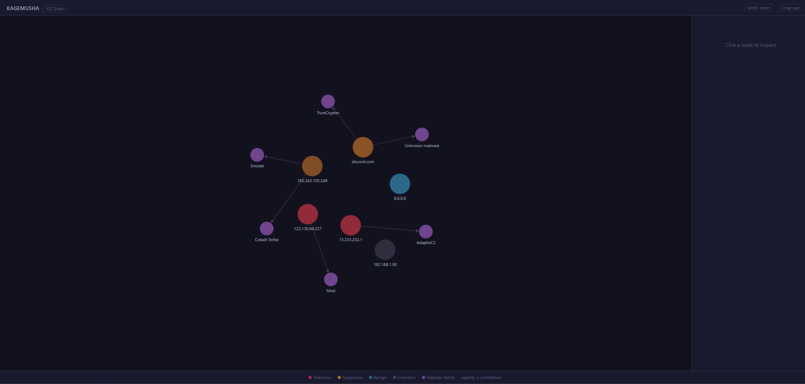
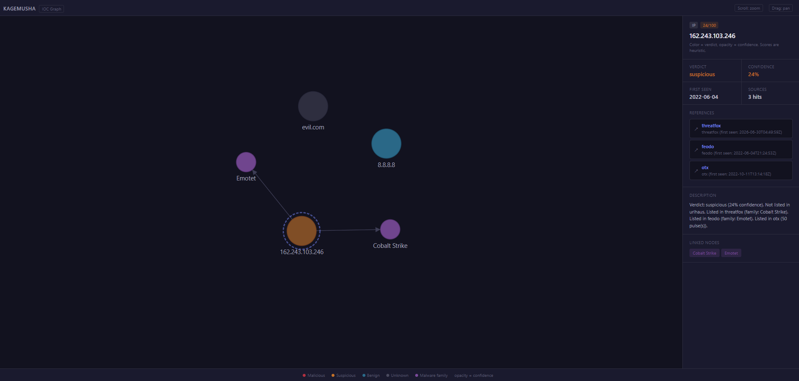

# Kagemusha

IOC triage engine for threat intelligence. Give it IPs, domains, URLs or hashes; it checks them against threat feeds and false-positive lists and returns an explainable verdict with a confidence level. Written in Go with two small dependencies. Output as JSON, STIX 2.1 or an interactive HTML graph.



## Quick start

```bash
git clone https://github.com/DonobanR/kagemusha.git
cd kagemusha
cp config.example.yaml config.yaml   # add your abuse.ch key
go build -o kagemusha ./cmd/kagemusha
./kagemusha scan 162.243.103.246
```

You need a free abuse.ch Auth-Key (https://auth.abuse.ch/). An AlienVault OTX key (https://otx.alienvault.com/api) is optional and improves coverage.

## Example

```
$ ./kagemusha scan 162.243.103.246
```

```json
[
  {
    "target": "162.243.103.246",
    "type": "ipv4",
    "verdict": "suspicious",
    "confidence": 24,
    "reasons": [
      {"code": "threatfox_listed", "message": "Listed in threatfox (family: Cobalt Strike)"},
      {"code": "feodo_listed", "message": "Listed in feodo (family: Emotet)"},
      {"code": "otx_listed", "message": "Listed in otx (50 pulse(s))"}
    ]
  }
]
```

Output trimmed: the full result is an array with one object per IOC, and also lists every source with its status, dates and reference links.

**Why suspicious at 24%?** The IP is a known Emotet C2, but the evidence from the curated feeds is months old. Evidence loses weight over time (30-day half-life for IPs, 90 for domains and URLs), so there is no fresh confirmation and the verdict stays at `suspicious` with low confidence. A freshly reported C2 reaches `malicious`.

## Output formats

| Flag | Output |
|---|---|
| `--json` (default) | Every scanned IOC with verdict, confidence, reasons and per-source detail. |
| `--stix` | STIX 2.1 bundle (Indicator, Malware, Relationship) with deterministic IDs. Only actionable results. |
| `--html` | Self-contained interactive graph of every scanned IOC and its malware families. |

The three flags are mutually exclusive. Use `--out FILE` to write to a file.

### HTML graph report

```bash
./kagemusha scan --html --out report.html 162.243.103.246 8.8.8.8 evil.com
```

One node per IOC and one per malware family. Color shows the verdict (red malicious, orange suspicious, blue benign, grey unknown, purple malware family) and opacity shows confidence. Click a node for details and source links; scroll to zoom, drag to pan.



### STIX bundle

```bash
./kagemusha scan --stix --out bundle.json 162.243.103.246
```

The bundle leaves out results that are not actionable in a SIEM: `benign`, `unknown`, historical-only evidence, and threats on top-100k domains, where a domain-level indicator would be too broad.

## How it decides

| Condition | Verdict |
|---|---|
| A **fresh anchor** and FP score < 60 | **malicious** |
| Threat score >= 30, or any anchor while FP score < 60 | **suspicious** (`historical` flag when only a stale anchor) |
| FP score >= 60 and threat score < 30 | **benign** |
| Otherwise | **unknown** |

An **anchor** is a curated source: URLhaus, Feodo Tracker, or a ThreatFox entry reported by `abuse_ch` with type `botnet_cc`. It is **fresh** while its age-decay factor is >= 0.5. Hashes never decay.

The verdict says what a curated source asserts; the confidence says how much it is corroborated. All abuse.ch sources count as one voter, so a verdict backed only by them is capped at 60%. Going higher needs an independent source such as OTX.

| Threat source | Weight | Covers |
|---|---|---|
| Feodo Tracker | 40 (anchor) | IPv4 |
| URLhaus | 35 (anchor) | domains, IPs, URLs, hashes |
| ThreatFox | 30 (40 if anchor-grade) | domains, IPs, URLs, MD5, SHA-256 |
| AlienVault OTX | 20 | domains, IPs, URLs, hashes |

**False positives.** Tranco top 1M adds 30 to the FP score and top 100k adds 30 more. An FP score of 60 vetoes `malicious`. Subdomains inherit the rank of their parent domain, except under public suffixes such as `github.io`.

**Things it will not guess.** Private and reserved addresses return `unknown` (not routable). If a threat source fails, the result is marked `partial` and is never reported as `benign`. Cloud hosting is shown as context and never lowers a score.

More detail in [docs/design.md](docs/design.md).

## Configuration

Keys are read from, in order: CLI flags, environment variables (`KAGEMUSHA_ABUSECH_AUTH_KEY`, `KAGEMUSHA_OTX_API_KEY`), then `./config.yaml` if it exists, otherwise the global config file.

```yaml
# config.yaml
abusech_auth_key: "your-key-here"
otx_api_key: "your-otx-key-here"
```

Common flags:

```
--out FILE           write output to a file
--timeout DURATION   abort the scan after a duration (30s, 2m)
--workers N          concurrent IOCs (default 10)
--low-memory         slower Tranco lookups, ~15 MB instead of ~120 MB
--verbose            debug info on stderr
```

All flags, exit codes and config paths are in [docs/usage.md](docs/usage.md).

## Limitations (v0.1)

1. An IOC reported only by a third party in ThreatFox stays `suspicious`, even if recent.
2. Hashes have only URLhaus as an anchor.
3. Feodo Tracker has been frozen since 2026-03 (5 entries).
4. The malware family reported by OTX is not reliable.
5. A subdomain of a top-100k domain inherits the FP veto even if the abuse on it is real.
6. The HTML report does not show the `historical` and `partial` flags or the cloud-hosting context; those are only in the JSON output.
7. STIX output is minimal: Indicator, Malware and Relationship objects only.

## Requirements

Go 1.27 or later.

## License

Apache License 2.0. See [LICENSE](LICENSE).
